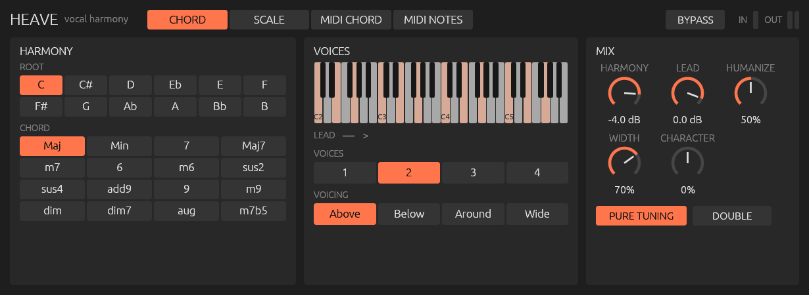

# Heave

Harmonizador vocal em Rust ([truce](https://github.com/truce-audio/truce)), AU e VST3 para macOS.
Põe até 4 vozes de harmonia (8 com **Double**) sobre a sua voz e soa como cantores de verdade
logo de cara, com poucos controles.



## Uso no Ableton Live

1. Coloque o **Heave** como efeito na faixa de voz (Audio Units → Jardim Sonoro → Heave).
2. Escolha de onde vem a harmonia (botões no topo):
   * **CHORD**: escolha **Root** e **Chord**. Para mudar os acordes ao longo da música,
     automatize os parâmetros *Root* e *Chord* na timeline (no Live: mostre a automação do
     device e desenhe os acordes). A troca acontece exatamente no ponto desenhado. Se você
     antecipa o tempo forte ao cantar, o Heave já usa o próximo acorde para a nota que começa
     até 80 ms antes da troca.
   * **SCALE**: só a tonalidade (**Key** + **Scale**). As vozes andam em terças diatônicas,
     sem precisar de acordes.
   * **MIDI CHORD**: toque ou grave acordes numa faixa MIDI. Na faixa MIDI, em *MIDI To*,
     escolha a faixa de voz e depois *Heave*. As vozes escolhem as melhores notas do acorde.
   * **MIDI NOTES**: cada nota MIDI segurada vira uma voz (até 4), na altura exata.
3. **VOICES** (1–4) e **VOICING**:
   * *Above*: harmonia fechada acima do lead.
   * *Below*: harmonia abaixo.
   * *Around*: vozes acima e abaixo.
   * *Wide*: acorde aberto.
4. **MIX**:
   * **Harmony**: nível do grupo de vozes. Mudar o número de vozes não muda o volume.
   * **Lead**: nível da voz original. No mínimo, sai só a harmonia.
   * **Humanize**: quanto cada cantor virtual difere: atraso, deriva de afinação, timbre e nível.
   * **Width**: abertura estéreo.
   * **Character**: garganta mais longa (voz mais escura) ou mais curta (mais clara).
   * **Pure Tuning**: afina os intervalos com o lead em entonação justa, como um grupo
     a cappella.
   * **Double**: dois cantores por voz.

**Latência:** 80 ms, reportada ao host. O Live compensa automaticamente na reprodução e na
mixagem. Para gravar ouvindo a harmonia ao vivo, o atraso de 80 ms é perceptível. Grave a voz
seca e use o Heave na mixagem.

## Como funciona

* **Altura do lead:** YIN via FFT a cada 4 ms. A escolha de candidatos usa continuidade.
  Há testes de oitava e de sub-harmônico que tratam voz *creaky* e 2º harmônico forte, e um
  "portão de tessitura" que rejeita leituras longe da região onde o cantor está.
* **Marcas de época:** uma por ciclo glotal, mantidas por correlação cruzada. Os grãos somam
  em fase: sem *phasing* nem aspereza.
* **Shifter PSOLA:** janela de Hann de 2 períodos, interpolação cúbica fracionária e formantes
  preservadas. Erro residual de envelope < 1 dB de −12 a +12 semitons. Atrasos humanizados
  repetem ou pulam ciclos inteiros, sem efeito Doppler.
* **Plano harmônico:** 30 ms de *lookahead* sobre a nota em que o cantor vai chegar, e
  histerese contra o vibrato. As notas das vozes vêm de uma busca exaustiva com custo de
  arranjo vocal: notas do acorde; sem segunda menor contra o lead; condução suave sem quintas
  paralelas; acorde completo; shifts moderados.
* **Transições:** a harmonia sai da nota antiga para a nova na *mesma proporção* do glide do
  lead. Nota comum fica parada, como num arranjo real.
* **Expressão:** a harmonia segue a entonação do lead (85%) e parte do vibrato (55%). Em
  scoops e glissandos segue tudo.
* **Consoantes:** a −10 dB nas harmonias e sibilantes a −15 dB (sibilantes multiplicadas
  soam artificiais). Caudas sopradas seguem harmonizadas, mais baixas, em vez de virarem
  uníssono.

## Desenvolvimento

```bash
cargo truce install --au2 --vst3      # compila, assina e instala
cargo test --release --no-default-features
cargo run --release --no-default-features --bin heave_cli -- voz.wav saida.wav \
    mode=chord voices=3 voicing=around chords="0:Am,4:F,8:C,12:G" double=1
cargo truce screenshot --out docs/gui.png
```

Validação: `auval -v aumf Heav JdSn` e `pluginval --strictness-level 10` passam.
