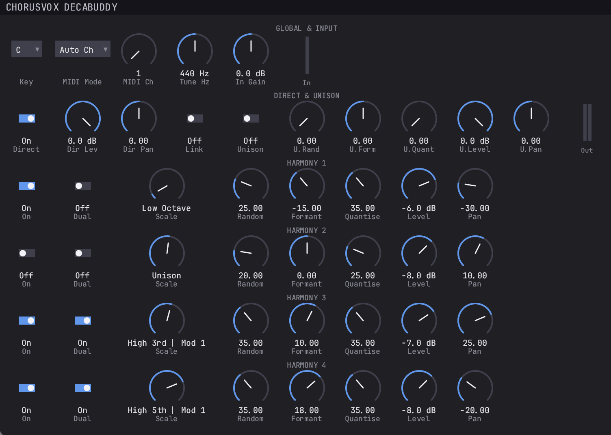

# ChorusVox DecaBuddy 🎙️🎛️

[-blue.svg)](#-macos-installation--release-assets)
[](https://www.rust-lang.org/)
[](LICENSE)

**ChorusVox DecaBuddy** is a real-time vocal harmony generator and component-modeled virtual analog processor written in Rust. It re-engineers and expands the classic **Akai Professional DecaBuddy HV10** hardware rack unit (1999) and its vintage PC companion (`DecaBuddy.dll` v1.02).

By combining all **37 original chromatic scale lookup tables and floating-point constants** extracted from the original Akai binary with component-level analog and fixed-point DSP modeling derived from the **Akai HV10 Service Manual (`PC MAIN BLK L8020A501A`)**, ChorusVox delivers thick, organic vintage vocal harmonies alongside a **Zero-Latency Live Monitoring Engine** and an intelligent **Jazz Harmony Engine (`FlexiChd`)**.

---

<p align="center">
  
</p>

---

## 🍎 macOS Installation & Release Assets

Pre-compiled binary releases are packaged exclusively for **macOS** (Apple Silicon & Intel Universal, supporting Ableton Live, Logic Pro, Reaper, Bitwig, Studio One, Cubase, etc.).

1. Open the **[Releases](../../releases)** page of this repository.
2. Under the latest version, expand the **Assets** section and download **`ChorusVox-DecaBuddy-macOS-AU-VST3.zip`** *(do not download the `Source code.zip` archive)*.
3. Extract the archive and move the bundles into your macOS audio plug-in folders:
   * **Audio Unit (AUv2):** Copy `ChorusVox DecaBuddy.component` to:
     ```bash
     ~/Library/Audio/Plug-Ins/Components/
     ```
   * **VST3:** Copy `ChorusVox DecaBuddy.vst3` to:
     ```bash
     ~/Library/Audio/Plug-Ins/VST3/
     ```
4. Restart your DAW to rescan plug-ins.

---

## 📖 Operational Manual & Parameter Reference

The interface is organized into 6 horizontal strips: **Global & Input**, **Direct & Unison**, and four independent harmony channels (**VOX 1** through **VOX 4**).

### 1. `GLOBAL & INPUT` Strip

Controls root key, incoming MIDI chord parsing, master concert pitch, input transformer/preamp drive, latency mode, and input peak metering.

| Control | Range / Options | Description |
| :--- | :--- | :--- |
| **Key** | `C`, `C#`, `D`, `D#`, `E`, `F`, `F#`, `G`, `G#`, `A`, `A#`, `B` | Sets the musical root key for all harmony voices assigned to automatic scales (Modal 1–5, Harmonic Minor, Melodic Minor, etc.). |
| **MIDI Mode** | `Auto Ch`, `Mono (1-4)`, `Wait All`, `Priority`, `FlexiChd` | Selects the MIDI voice-allocation algorithm for any harmony voice whose **Scale** knob is set to **`MIDI`**. |
| **MIDI Ch** | `1` to `16` | Sets the base MIDI channel. In `Mono (1-4)` mode, voices 1 to 4 listen consecutively on `MIDI Ch` through `MIDI Ch + 3`. |
| **Tune Hz** | `427 Hz` to `453 Hz` *(Default: `440 Hz`)* | Calibrates master concert A4 reference frequency for the YIN pitch tracker. |
| **In Gain** | `-15.0 dB` to `+15.0 dB` *(Default: `0.0 dB`)* | Adjusts input drive into the discrete input buffer stage. Pushing above `0 dB` increases warm 2nd-harmonic saturation. |
| **Drive** | `0.0%` to `100.0%` *(Default: `35.0%`)* | Controls analog warmth and drive in the **ChoirAnalogBus** (Ariwa 185 Hz console warmth shelf, JRC NJM4558L symmetric rail saturation, 9V DC dynamic power supply sag, and stereo crosstalk). Applied exclusively to synthesized choir voices. |
| **In** *(Meter)* | Vertical Bar | Ballistic input peak meter modeled after the `NJU7032D` (IC401) detector circuit and the 3 front-panel LEDs (`-12 dB`, `-6 dB`, `0 dB/Over`). |

> [!NOTE]
> **Automatic Live vs. Offline PDC Latency:** In real-time tracking, ChorusVox operates in **Live Mode** with **0 ms reported latency** to the DAW and **0 ms delay on the Direct path**. During offline DAW bounce/export (`is_offline`), full lookahead with 2496 samples of Plugin Delay Compensation (PDC) is engaged automatically.

#### Detailed MIDI Modes (`MIDI Mode`)

To control a voice via MIDI notes, set that voice's **Scale** knob to **`MIDI`** (fully counter-clockwise). All modes support **Sustain Pedal (`MIDI CC 64`)**:

* **`Auto Ch` (Vanilla / Hardware Default):** Deterministic Akai hardware behavior. Chord notes on `MIDI Ch` are sorted lowest-to-highest and assigned directly across active MIDI voices. If notes arrive on secondary channels (`MIDI Ch + 1..3`), it automatically switches to multi-channel allocation.
* **`Mono (1-4)`:** Voices 1 to 4 listen independently to consecutive MIDI channels (`MIDI Ch` to `MIDI Ch + 3`). Ideal for independent polyphonic counterpoint lines.
* **`Wait All`:** Harmony voices remain muted until the number of held MIDI notes equals or exceeds the number of active MIDI voices.
* **`Priority`:** Notes are assigned to voices in the exact chronological order keys are pressed.
* **`FlexiChd` (Intelligent Jazz Harmony Engine):** Hold any jazz chord (`Dmaj7`, `F#m6`, `9th`, `13th`, or 2-note guide-tone voicings) and **all 4 voices move dynamically with your sung melody** while locking onto chord tones:
  * **Dynamic Chord-Scale Inference:** Combines held MIDI chord notes with the global **Key** to support 2-note shell voicings and melodic passing tones.
  * **Voice Leading Memory:** Retains common tones stationary across chord changes (e.g., `F#`, `A`, `C#` between `Dmaj7` and `F#m6`).
  * **Anti-Clash ($b2/b9$ Prevention):** Prevents any harmony voice from landing 1 semitone away from the lead vocal.

---

### 2. `DIRECT & UNISON` Strip

Controls the lead vocal path, the 10th unison doubling voice, parameter linking, and stereo output metering.

| Control | Range / Options | Description |
| :--- | :--- | :--- |
| **Direct** | `On` / `Off` | Enables or mutes the dry lead vocal in the output bus. Turn `Off` when using the plugin on an auxiliary send/return bus. |
| **Dir Lev** | `-24.0 dB` to `0.0 dB` | Output level of the direct signal (`-24.0 dB` = full mute). |
| **Dir Pan** | `-50` (L) to `+50` (R) | Constant-power stereo pan position for the direct signal. |
| **Link** | `On` / `Off` | Mirrors `VOX 1` **Random**, **Formant**, and **Quantise** settings across `VOX 2`, `VOX 3`, and `VOX 4` while preserving each voice's individual **Scale**, **Level**, and **Pan**. |
| **Unison** | `On` / `Off` | Enables the dedicated 10th unison doubling voice (conditioned through an `8.5 kHz` warm analog low-pass filter). |
| **U.Rand** | `0.0` to `100.0` *(Default: `0.0`)* | Controls Ornstein-Uhlenbeck pitch drift ($\pm 9\text{ cents}$) and delay modulation for natural vocal doubling. Opens at `0.0` for 100% deterministic pitch and phase; humanization acts above `0.0`. |
| **U.Form** | `-50.0` to `+50.0` | Shifts vocal tract formant frequencies of the Unison voice without altering pitch. |
| **U.Quant** | `0.0` to `100.0` | Pitch quantization strength for the Unison voice. |
| **U.Level** | `-24.0 dB` to `0.0 dB` | Output level of the Unison voice. |
| **U.Pan** | `-50` (L) to `+50` (R) | Stereo pan position for the Unison voice. |
| **Out** *(Meter)* | Stereo Bar (L/R) | Peak output meter after stereo `PCM3003E` reconstruction and `NJM4558L` crosstalk modeling. |

---

### 3. Harmony Strips: `VOX 1`, `VOX 2`, `VOX 3`, `VOX 4`

Four independent PSOLA harmony channels. Engaging **Dual** on all 4 voices alongside **Direct** and **Unison** produces all **10 voices** of the DecaBuddy architecture.

| Control | Range / Options | Description |
| :--- | :--- | :--- |
| **On** | `On` / `Off` | Enables or disables the voice channel with a 40 ms anti-click envelope and zero CPU consumption when idle. |
| **Dual** | `On` / `Off` | Activates a twin sub-voice panned to the opposite stereo side (`-Pan`) with shifted formants, $-9\text{ cents}$ detune, $+14\text{ ms}$ Haas delay, and an `8.5 kHz` warm low-pass filter. |
| **Scale** | `37 Options` | Selects `MIDI`, custom `User` scale, or 35 Akai preset harmony tables (`Low Octave`, `Low 3rd`, `Low 5th`, `Low 7th`, `Unison`, `High 3rd`, `High 5th`, `High 7th`, `High Octave`). |
| **Random** | `0.0` to `100.0` *(Default: `0.0`)* | Humanizes pitch drift ($\pm 9\text{ cents}$) and timing micro-jitter per sub-voice. Opens at `0.0` for 100% deterministic pitch and phase; Ornstein-Uhlenbeck drift and dynamic 9V sag micro-cents act above `0.0`. |
| **Formant** | `-50.0` to `+50.0` | Shifts vocal tract formant envelope with strict formant preservation (`src_step = formant_ratio`). |
| **Quantise** | `0.0` to `100.0` | Blends between natural vocal inflection tracking (`0%`) and chromatic grid locking (`100%`). |
| **Level** | `-24.0 dB` to `0.0 dB` | Channel output level. |
| **Pan** | `-50` (L) to `+50` (R) | Stereo pan position for the main voice (and mirror `-Pan` for the Dual voice). |

---

## 🔬 Hardware Simulation Architecture (Akai HV10 & Ariwa Studio)

```text
               ┌─────────────────────────────────────────────────────────────┐
               │           INPUT SIGNAL (Mono L or Summed L + R)             │
               └──────────────────────────────┬──────────────────────────────┘
                                              │
                      ┌───────────────────────┴───────────────────────┐
                      │                                               │
           [ DIRECT LINEAR PATH ]                          [ DIGITAL DSP PATH ]
           • Mechanical Relays (RL1/RL2 RY-9WK)            (Burr-Brown PCM3003E ADC)
           • 100% Linear & Transparent (0% THD)                       │
           • 20 Hz - 20 kHz Flat Response                             │
           • Live: 0 ms delay / Studio: 2496 PDC                      ▼
                      │                       ┌───────────────────────────────────────────────┐
                      │                       │ 1. TIME-SLICED YIN & SIBILANCE ENGINE         │
                      │                       │ • 1536-Sample Synchronous Window (down to 42Hz│
                      │                       │ • Adaptive ~22.05 kHz Decimation (2x/4x/8x SR)│
                      │                       │ • Peak Glottal Epoch Tracker on Filtered LP   │
                      │                       │ • Zero-Crossing Rate & High-Freq Sibilance Det│
                      │                       └───────────────────────┬───────────────────────┘
                      │                                               │
                      │                                               ▼
                      │                       ┌───────────────────────────────────────────────┐
                      │                       │ 2. 10x TD-PSOLA ENGINE (ADSP-2186M HERITAGE)  │
                      │                       │ • 4-Point Hermite Cubic Interpolation (C1)    │
                      │                       │ • Strict Formant Preservation (src_step = fr) │
                      │                       │ • 8192-Sample L1 Interleaved Ring Buffer      │
                      │                       │ • Exact 50% Hann Overlap-Add (NOLA sum = 1.0) │
                      │                       │ • Post-NOLA 16-bit Q15 Quantizer + 40-bit MAC │
                      │                       │ • Akai 32.78 Hz Subsonic HPF & Voice DAC LPF  │
                      │                       └───────────────────────┬───────────────────────┘
                      │                                               │
                      │                                               ▼
                      │                       ┌───────────────────────────────────────────────┐
                      │                       │ 3. CHOIR ANALOG BUS (ARIWA STUDIO & HV10)     │
                      │                       │ • Ariwa Console 185 Hz Low-Mid Warmth Shelf   │
                      │                       │ • 9V DC / 250mA Dynamic Power Supply Sag      │
                      │                       │   (Modeled on C22 220µF Electrolytic Cap)     │
                      │                       │ • JRC NJM4558L Symmetric Rail Saturation      │
                      │                       │ • Sallen-Key Active LP Filter (16.8 kHz)      │
                      │                       │ • SIP-8 Dual-Opamp Stereo Crosstalk (-62 dB)  │
                      │                       └───────────────────────┬───────────────────────┘
                      │                                               │
                      └───────────────────────┬───────────────────────┘
                                              ▼
               ┌─────────────────────────────────────────────────────────────┐
               │ 4. MASTER SUM & ANALOG BUS SOFT LIMITER                     │
               │ • Transparent Linear Pass-Through for |x| <= 0.92 (0% THD)  │
               │ • C1-Continuous Asymptotic Soft-Knee (Neve/Tape saturation) │
               │ • Zero Hard Digital Clipping Artifacts                      │
               └──────────────────────────────┬──────────────────────────────┘
                                              │
                                              ▼
                             STEREO OUTPUT (Left / Right)
```

---

## 🎯 ToDo's & Next-Generation Engineering Roadmap

### A. Deeper HV10 Hardware & Studio Dub Chain Emulation
- [ ] **PCM3003E Delta-Sigma Modulator & Clock Jitter (`X1 11.2896 MHz`):** Model the 64x oversampled 1-bit Delta-Sigma DAC stage of the Burr-Brown `PCM3003E` (`IC3`) and the phase jitter of the `11.2896 MHz` crystal oscillator (`X1`) divided through the `HD74HC93P` (`IC5`) ripple counter.
- [ ] **Mechanical Bypass Relay Transient Modeling (`RL1` / `RL2` `RY-9WK`):** Emulate the micro-inductive contact bounce and impedance transition of the physical 9V signal relays `RL1` and `RL2` when toggling hardware bypass.
- [ ] **Ariwa Dub Console & Tape Feedback Send Emulation:** Add an optional post-harmony analog dub send loop inspired by Mad Professor's Ariwa studio workflow (modeling Soundcraft console transformer drive, spring reverb dispersion, and Akai 4000DS reel-to-reel tape saturation).
- [ ] **Electrolytic Coupling Capacitor Dielectric Absorption:** Model the low-frequency phase shift and dielectric memory of vintage 1990s Nichicon/Elna electrolytic coupling capacitors surrounding `IC12`–`IC14`.

### B. Advanced Vocal DSP & Performance Optimizations
- [ ] **Glottal Closure Instant (GCI) SEDREAMS / DYPSA Detector:** Replace simple low-pass peak epoch picking with a phase-slope zero-crossing Glottal Closure Instant detector for rock-solid epoch placement during raspy or creaky vocals (*vocal fry*).
- [ ] **True Cepstral / Higher-Order LPC (Order 12–16) Envelope Warping:** Expand the 4th-order LPC morpher to a 14th-order warble-free cepstral lifter scaled by sample rate for studio-grade gender/throat modeling.
- [ ] **Apple Accelerate (`vDSP`) & x86 `AVX-512` Batch Autocorrelation:** Offload the entire YIN cumulative mean normalized difference matrix to Apple Silicon AMX coprocessors via `vDSP` on macOS.
- [ ] **Custom GPU-Accelerated Vector UI (`wgpu`):** Build a custom hardware-styled rack interface featuring pastel voice color coding, real-time glottal waveform display, interactive 12-key `User` scale matrix, and authentic Akai 16x2 backlit LCD telemetry (`L1672B1J000`).
